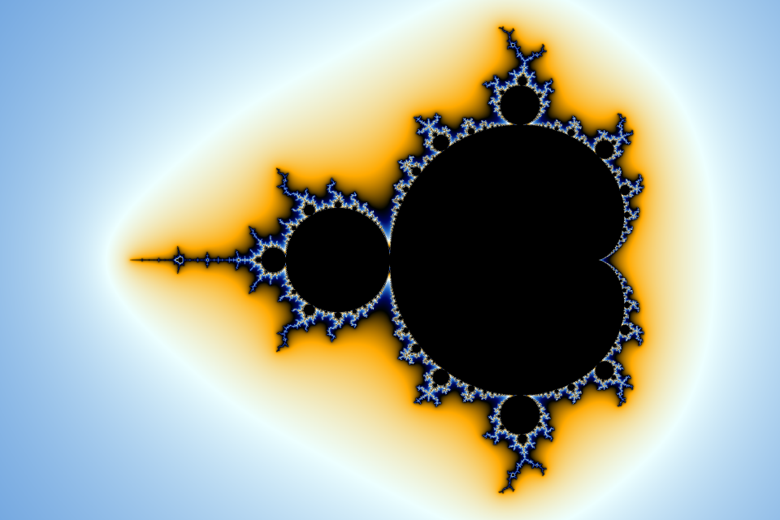
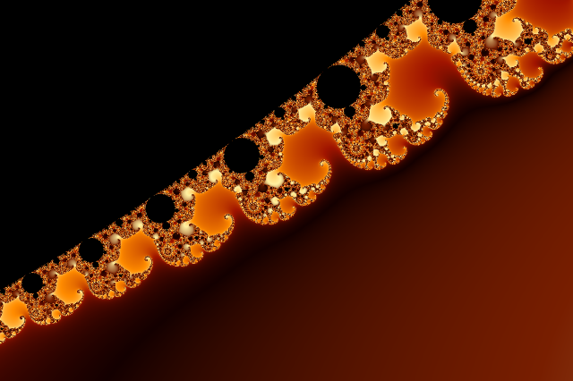

# Mandelbrot

[](https://github.com/tosjo/Mandelbrot/actions/workflows/ci.yml)

A fast, multithreaded Mandelbrot set renderer written in modern C++17. It renders
straight to PNG with smooth (banding-free) coloring, optional anti-aliasing and a
handful of color palettes, and has no dependencies beyond the standard library.



| Seahorse valley | Elephant valley |
| --- | --- |
|  |  |

## Features

- **Multithreaded**: rows are handed out to all CPU cores dynamically, so the
  expensive rows near the set don't hold up the rest of the image.
- **Smooth coloring** using the normalized iteration count, mapped onto cyclic
  gradients (`classic`, `fire`, `ocean`, `grayscale`).
- **Anti-aliasing** through N×N supersampling.
- **Built-in PNG encoder** (adaptive scanline filters + DEFLATE), or plain PPM output.
- **Fast paths** for points in the main cardioid and the period-2 bulb.
- Cross-platform: tested on Linux (GCC, Clang), macOS (Apple Clang) and Windows (MSVC).

## Building

You need CMake 3.16+ and a C++17 compiler.

```sh
cmake -S . -B build -DCMAKE_BUILD_TYPE=Release
cmake --build build --config Release
ctest --test-dir build --build-config Release   # optional: run the tests
```

The executable ends up in `build/` (or `build/Release/` with Visual Studio).

## Usage

```sh
# The whole set, 1200x800
./build/mandelbrot

# Seahorse valley in full HD with 2x2 anti-aliasing
./build/mandelbrot -s 1920x1080 -c -0.743643887037151,0.13182590420533 -z 2000 -i 4000 -a 2 -o seahorse.png

# Elephant valley with the fire palette
./build/mandelbrot -s 1280x852 -c 0.2925,0.0149 -z 120 -i 3000 -a 2 -p fire -o elephants.png
```

| Option | Description | Default |
| --- | --- | --- |
| `-s`, `--size WxH` | Image size in pixels | `1200x800` |
| `-c`, `--center RE,IM` | Point in the complex plane at the center of the image | `-0.75,0` |
| `-z`, `--zoom FACTOR` | Magnification; at `1` the shorter image side spans 2.5 units | `1` |
| `-i`, `--iterations N` | Maximum iterations per point; raise it for deep zooms | `1000` |
| `-a`, `--antialias N` | Supersample N×N points per pixel (1–8) | `1` |
| `-p`, `--palette NAME` | `classic`, `fire`, `ocean` or `grayscale` | `classic` |
| `-t`, `--threads N` | Number of worker threads, `0` uses all cores | `0` |
| `-o`, `--output FILE` | Output file; `.ppm` writes PPM, anything else PNG | `mandelbrot.png` |
| `-q`, `--quiet` | Don't print timing information | |
| `-h`, `--help` | Show help | |

Long options also accept the `--option=value` form.

## How it works

For every pixel the renderer iterates `z = z² + c` starting from `z = 0`. Points
whose orbit stays bounded are part of the set and are drawn black. For the other
points, the escape speed is turned into a continuous value

    ν = n + 1 − log₂(log |zₙ|)

which removes the visible bands you get from coloring by the plain iteration
count `n`. A large bailout radius (256) keeps that estimate accurate. The value is
then mapped onto a cyclic color gradient using a square-root scale, so color bands
keep a similar width whether you are looking at the whole set or zoomed in far.

Doubles give out at a zoom of roughly 10¹³; beyond that the image becomes blocky.

## Project layout

```
include/mandelbrot/   public headers (image, palette, renderer, PNG writer, options)
src/                  implementation and the command line entry point
tests/                unit tests and command line smoke tests (run with ctest)
docs/                 example renders used in this README
```

## License

[MIT](LICENSE)
